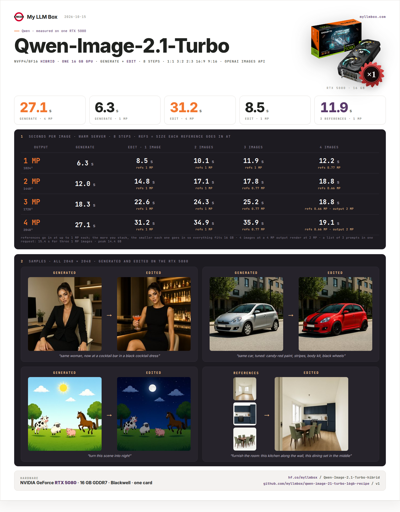
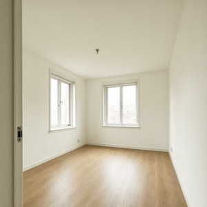
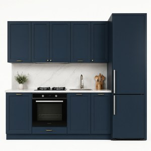
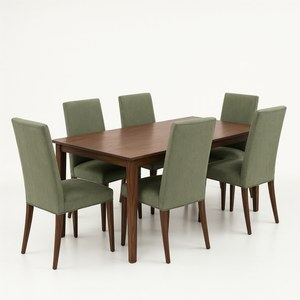
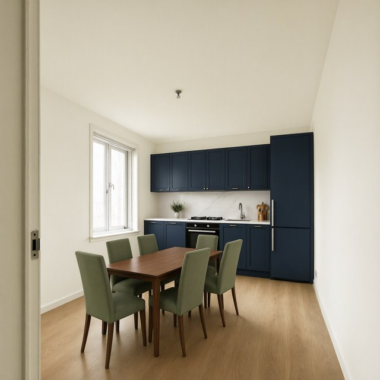

# Qwen-Image-2.1-Turbo on one 16 GB GPU

[Qwen-Image-2.1-Turbo](https://huggingface.co/Qwen/Qwen-Image-2.1-Turbo) — text-to-image and image editing in 8 steps — as our
NVFP4/BF16 [hibrid](https://huggingface.co/myllmbox/Qwen-Image-2.1-Turbo-hibrid) on a single RTX 50-series card with 16 GB.
**A 1 MP image in 6 s, 4 MP in 27 s, edits with up to 4 reference images.** OpenAI Images API. One command.

**Non-commercial use only** (Qwen Research License). Built with Qwen.



| generate | → edit |
|---|---|
|  |  *"same woman, now at a cocktail bar in a black cocktail dress"* |
|  |  *"same car, tuned: candy-red paint, stripes, body kit, black wheels"* |
|  |  *"turn this scene into night"* |

Three reference images → one edit: *"furnish the room: this kitchen along the wall, this dining set in the middle"*

|  |  |  |  |
|---|---|---|---|

## Measured (RTX 5080 16 GB, image v1, warm server)

Seconds per image (8 steps). Edits: the output size you ask for, with 1-4 reference images; "refs" = the size each reference
goes in at.

| output | generate | edit, 1 image | 2 images | 3 images | 4 images |
|---|---|---|---|---|---|
| **1 MP** (1024²) | **6.3** | 8.5 · refs 1 MP | 10.1 · refs 1 MP | 11.9 · refs 1 MP | 12.2 · refs 0.77 MP |
| **2 MP** (1440²) | **12.0** | 14.8 · refs 1 MP | 17.1 · refs 1 MP | 17.8 · refs 0.77 MP | 18.8 · refs 0.66 MP |
| **3 MP** (1728²) | **18.3** | 22.6 · refs 1 MP | 24.3 · refs 1 MP | 25.2 · refs 0.77 MP | 18.8 · refs 0.66 MP, output 2 MP |
| **4 MP** (2048²) | **27.1** | 31.2 · refs 1 MP | 34.9 · refs 1 MP | 35.9 · refs 0.77 MP | 19.1 · refs 0.66 MP, output 2 MP |

A list of 3 prompts in one request: **15.4 s** for all three 1 MP images. GPU memory peaks at 14.4 GB. The first image after a
start also reads the weights from disk (+5-7 s).

## What fits

- **Sizes:** `1:1` `3:2` `2:3` `4:3` `3:4` `16:9` `9:16` (the model's 4 MP presets: 2048², 2528×1696, 2752×1536, …) or any
  `WIDTHxHEIGHT`. An edit without a size renders at the preset matching its last reference image.
- **Reference images:** up to 4 per edit, each up to 1 MP. **The more you stack, the smaller each reference goes in** so that
  everything fits in memory (3 images: 0.77 MP each at a 4 MP output); with 4 images the output drops to 2 MP first. The
  response says what changed (`_adjusted`).
- **Several images at once:** `n` up to 4, or `prompt` as a list of up to 8 prompts — one image each, in order.

## Quick start

```bash
git clone https://github.com/myllmbox/qwen-image-21-turbo-16gb-recipe.git
cd qwen-image-21-turbo-16gb-recipe
./run.sh        # first run downloads ~14.5G, then serves on :8000 and renders ./smoke.png
```

`./stop.sh` stops it. `./view.sh` shows the live log. Requirements: Linux, docker + the NVIDIA container toolkit, driver 590
or newer, a Blackwell GPU (RTX 50-series) with 16 GB that nothing else uses — the weights are NVFP4 and do not run on older
cards. ~16 GB of system RAM.

**All configuration lives in [`recipe.yaml`](recipe.yaml)** — image, weights, port, default size, limits per request.

## API

```bash
# generate (16:9, 4 MP)
curl http://127.0.0.1:8000/v1/images/generations -H 'Content-Type: application/json' -d '{
  "prompt": "A lighthouse on a cliff at sunset, oil painting", "size": "16:9", "seed": 7
}' | jq -r '.data[0].b64_json' | base64 -d > lighthouse.png

# several prompts in one request (one image each)
curl http://127.0.0.1:8000/v1/images/generations -H 'Content-Type: application/json' -d '{
  "prompt": ["a red apple", "a green pear", "a yellow banana"], "size": "1024x1024"
}'

# edit with reference images (size defaults to the matching preset)
curl http://127.0.0.1:8000/v1/images/edits \
  -F prompt="Put the dining set from the second image into the room from the first image" \
  -F image=@room.png -F image=@dining-set.png
```

Any OpenAI Images client works (`/v1/images/generations`, `/v1/images/edits`). Extra fields: `seed`, `size` (ratio or WxH),
`reference_size` (megapixels per reference image, default 1).

## Image

`myllmbox/qwen-image-21-turbo-hibrid:v1` — digest `sha256:404ccff8aff1f909a8246379dcb27a2fedc48dafedd262d5afcf3b765030f45b`

## License

Weights: [Qwen Research License](https://huggingface.co/myllmbox/Qwen-Image-2.1-Turbo-hibrid/blob/main/LICENSE) —
non-commercial. Kit scripts: MIT.
